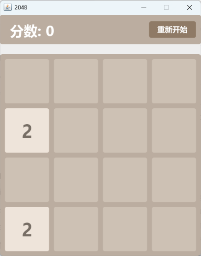
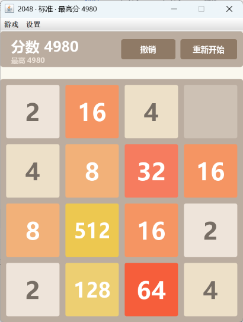
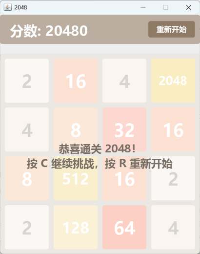
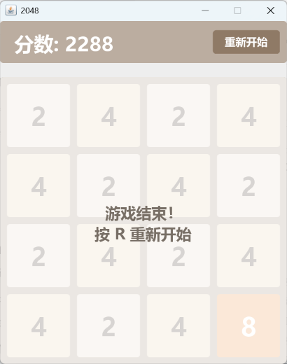

# Game 2048 — Java Swing 实现

一个基于 Java Swing 实现的 2048 小游戏，Java 程序设计课程的实验项目。

从最初的单文件版本重构而来：现在按 model / view / storage / ai 分层，配有 44 个 JUnit 用例和 Maven 构建。

## 界面预览

<table>
  <tr>
    <td align="center"><br/>开始界面</td>
    <td align="center"><br/>游戏进行中</td>
  </tr>
  <tr>
    <td align="center"><br/>通关（按 C 可继续）</td>
    <td align="center"><br/>游戏结束（按 R 重新开始）</td>
  </tr>
</table>

> **说明**：「通关」截图中的 2048 棋盘是演示效果——为了展示通关遮罩，截图程序直接把棋盘置成含 2048 的状态来触发判定。作者本人目前尚未通关，欢迎大家积极挑战；通关后可以把通关截图发到仓库的 Discussion 区一起交流！

## 功能特性

**核心玩法**

- 4×4 棋盘，标准 2048 规则
- 方向键（↑ ↓ ← →）或 `W` `A` `S` `D` 控制移动
- 鼠标拖拽棋盘也能移动，四个方向按拖动方向判定
- 方块滑动与合并带 110 ms 缓动动画
- 合成 2048 触发通关提示，此局定格，按 `C` 继续挑战更高分
- 无空格且无相邻可合并方块时游戏结束

**辅助功能**

- 撤销一步：按 `U`（或 `Z`）回退，最多保留 30 步历史
- 最高分持久化到 `~/.game2048-highscore`，标题栏与分数栏同时显示
- 难度可选：简单 / 标准 / 困难，分别按 10% / 25% / 50% 的概率生成 4
- 浅色 / 深色主题切换
- 音效：移动、合并、通关、失败各有合成音，可随时关闭；系统没有音频设备时自动静默
- AI 提示：按 `H` 由 expectimax 搜索给出推荐方向，棋盘上显示方向箭头
- AI 自动演示：按 `P` 让 AI 每 120 ms 走一步，中途再按一次停止

**界面**

- 顶部显示当前分数、历史最高分，右侧是「撤销」「重新开始」按钮
- 菜单栏「游戏」：重新开始、撤销一步、继续挑战、AI 提示、自动演示、退出
- 菜单栏「设置」：难度、主题、音效
- 游戏结束 / 通关时只在棋盘区盖半透明遮罩，分数栏与按钮保持清晰可见
- 快捷键绑定在窗口级 `KeyEventDispatcher` 上，点过按钮或菜单后依然有效

## 快捷键

| 按键 | 作用 |
| --- | --- |
| `↑` `↓` `←` `→` / `W` `A` `S` `D` | 移动方块 |
| `U` / `Z` | 撤销一步 |
| `R` | 重新开始 |
| `C` | 通关后继续挑战 |
| `H` | AI 提示下一步 |
| `P` | 开始 / 停止 AI 自动演示 |
| `M` | 开关音效 |
| `T` | 切换浅色 / 深色主题 |

## 项目结构

```
src/main/java/game2048/
  Game2048.java          入口：装配 model / view 后启动窗口
  model/
    Board.java           棋盘与合并算法（slideRow 为纯函数）
    MoveResult.java      一步移动的结果：得分、是否移动、每个方块的位移
    TileMove.java        单个方块的位移记录（动画用）
    RowSlide.java        单行滑动的结果
    Direction.java       四个方向及其行列映射
    Difficulty.java      难度与新方块概率
    Game.java            游戏状态机：分数、最高分、撤销历史、胜负
  view/
    GameFrame.java       窗口、菜单、按钮、快捷键、自动演示
    BoardPanel.java      棋盘绘制、动画、拖拽、遮罩、方向提示
    FlatButton.java      自绘圆角按钮
    Theme.java           配色与字体探测
    SoundPlayer.java     合成音效播放
  ai/
    AiSolver.java        expectimax 搜索，用于提示与自动演示
  storage/
    HighScoreStore.java  最高分读写
src/test/java/game2048/  44 个 JUnit 用例
```

## 实现说明

- **棋盘与合并**：`Board.slideRow(int[])` 是纯函数——先压缩（去掉 0），再把相邻相同数字两两合并（每格每步只合并一次），最后再压缩；返回合并得分，不碰任何全局状态。`Board.move()` 在滑动前后对比位置，为每个方块记录 `TileMove`，界面据此做位移动画。
- **四个方向**：`Direction` 提供行列映射，`Board.move()` 用旋转视图把四个方向统一成同一套「向一侧滑动」的逻辑。
- **状态机**：`Game` 持有分数、最高分、`Status`（PLAYING / WON / OVER）和撤销栈。每次有效移动前压入快照（上限 30 步）；通关那一步不补随机方块，`hasWon()` 保证通关提示只弹一次；`continueAfterWin()` 把状态切回 PLAYING 并补判负。
- **最高分**：`HighScoreStore` 用一个纯文本文件存最高分，路径默认 `~/.game2048-highscore`；读写异常全部吞掉，读不出或文件损坏时按 0 处理，不影响游戏。
- **AI**：`AiSolver` 做深度 2 的 expectimax，评估函数综合空格数、行平滑度、单调性和最大值对数；没有合法移动时返回 `null`。
- **界面**：`BoardPanel` 记录每步的方块位移，用 110 ms 缓动插值绘制，合并的目标格在动画期间先画空格；遮罩只覆盖棋盘矩形；`Theme` 在启动时探测可用中文字体（微软雅黑 → 黑体 → 逻辑字体），避免硬编码字体名在别的系统上显示成方块。

## 构建与运行

需要 JDK 8 及以上；用 Maven 构建还需要 Maven 3.6+。

```bash
# 编译、跑测试、打包
mvn clean package

# 运行
java -jar target/game2048.jar
```

只想跑测试：

```bash
mvn test
```

不用 Maven 时也可以直接编译（源码含中文，必须显式指定 UTF-8）：

```bash
javac -encoding UTF-8 -d out $(find src/main/java -name '*.java')
java -cp out game2048.Game2048
```

如果编译时出现 `warning: [path]` 之类的提示，检查一下 `CLASSPATH` 环境变量里是否还留着 `dt.jar`、`tools.jar`——这两个 jar 在 JDK 9 就已删除，把它们从 `CLASSPATH` 里去掉即可。

Windows 的命令提示符不支持 `$(...)`，可用：

```bat
dir /s /b src\main\java\*.java > sources.txt
javac -encoding UTF-8 -d out @sources.txt
java -cp out game2048.Game2048
```

PowerShell 里 `@sources.txt` 会被当成 splatting 语法报 `ParserError`，给参数文件加引号，或者干脆直接把文件列表展开：

```powershell
javac -encoding UTF-8 -d out "@sources.txt"
# 或者不生成参数文件
javac -encoding UTF-8 -d out (Get-ChildItem -Recurse src\main\java -Filter *.java).FullName
java -cp out game2048.Game2048
```

## 后续改进

- **存档与读档**：把当前局面序列化，支持关掉程序后接着玩。
- **撤销历史持久化**：目前撤销栈只存在内存里，重开后清空。
- **统计面板**：记录局数、平均分、最大方块、通关次数。
- **多套配色**：在浅色 / 深色之外再做几套复古或高对比配色。
- **AI 深度可调**：当前固定深度 2，可开放设置并显示搜索耗时。
